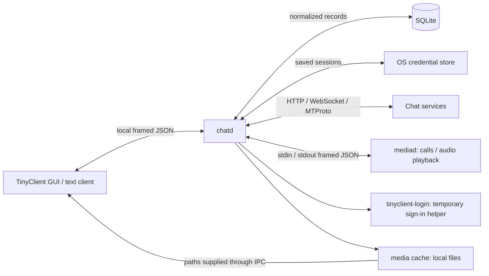

# Chatd: architecture, dependencies, history and replaceability

Chatd is TinyClient's background service. It owns accounts, network connections,
normalized chat data, pending sends and downloaded files. TinyClient is its
presentation client. The process boundary is deliberately local JSON IPC, so a
daemon implemented in another language is possible without rewriting the GUI.
The difficulty is reproducing the service behavior and adapters, not encoding
JSON or opening a socket.

This guide describes upstream `7b98c4c` on 18 October 2026. The Linux reconnect
change is separately identified as [PR #45](https://github.com/itz4blitz/tinyclient/pull/45),
open when this guide was prepared. The [IPC specification](chatd-ipc.md) and its
[type catalogue](chatd-ipc-types.md) are the implementation references for another
language. Statements about history are drawn from Git; design tradeoffs recorded
in module comments are attributed rather than treated as independently measured.

## The process boundary



The GUI draws rows and decodes images. It asks chatd for snapshots and changes;
it does not need to know each provider's authentication or message format.
Chatd downloads registered media and supplies local paths instead of sending
image bytes through the chat socket. Media decoding, audio devices and call
codecs belong to mediad or the GUI, not chatd. Video playback can be handed to
the system player. Mediad is started on demand for calls or audio playback;
pausing playback can terminate its process while retaining playback state.

The login helper exists for sign-in and returns session data to chatd. Some
providers also support sign-in steps modeled directly in the IPC. Sessions are
then restored by chatd independently of the window's lifetime.

This separation is useful for a rewrite: the replacement can retain the GUI,
login helper and media engine initially. Their protocols still need to be
implemented; helper reuse is not automatic just because executable names match.

## Startup and lifetime

Chatd determines its support directory, takes a lifetime lock on `chatd.lock`,
opens `chat.sqlite`, binds the local chat endpoint and restores sessions in the
background. The GUI can therefore read cached data before keychain unlocking
or remote connections finish. Readiness of the local socket and readiness of
Signal/Discord are different states.

TinyClient can launch the daemon directly, or use the enabled Linux user
systemd service. Direct launches write `chatd.log`; the service writes its
stdout/stderr to the journal. Typical Linux diagnostics are:

```sh
systemctl --user status tinyclient-chatd.service
journalctl --user -u tinyclient-chatd.service -n 50 --no-pager
```

A replacement executable can be selected with `TINYCLIENT_CHATD`. Use a distinct
`TINYCLIENT_DIR` for experiments; otherwise the GUI can find the original daemon
already answering and never launch the candidate.

## Internal organization

| Component | Responsibility |
| --- | --- |
| `server.rs` | Dispatch IPC requests, serve connections, orchestrate sign-in, sends and settings |
| `hub.rs` | Shared store access, account/link state, change cursors, Watch, bounded transient caches |
| `store.rs` | SQLite records, queries, retention, pending messages and local settings |
| `adapters/` | Per-provider connections and conversion to/from the shared model |
| `session.rs` | OS credential-store access, restoration and unlock handling |
| `blobs/`, `upload.rs` | Downloads, registered media variants, local files and upload lifecycle |
| `media.rs`, `playback.rs` | Supervise the media helper and expose its state to clients |
| `crates/protocol` | Wire types and framing shared with clients/helpers |

The reference implementation uses OS threads, mutexes, condition variables and
channels rather than one application-wide async event loop. Each IPC connection
has a serving thread; requests on that connection are sequential. Slow work on
one connection need not block another, although shared store locks and adapter
queues remain relevant.

One adapter runs per account. Its `Command` inbox expresses things to do; its
`Context` writes normalized data and announces changes. Network events are
translated into shared Conversation, Message, Person, Space and MediaFile values.
Adapter-specific state remains necessary for tokens, cursors, protocol sessions,
permissions and subscriptions.

This is not literally a daemon with no in-memory cache. SQLite is the main
persistent model, while the hub and adapters retain bounded presence, typing,
profiles, subscriptions and active member windows. The Discord member redesign
separates viewport/cache commands from HTTP/history work. Signal and Telegram
use their own current-thread Tokio runtimes inside their adapter threads because
their client libraries are asynchronous.

## How the GUI learns about changes

The client requests a snapshot, saves the current sequence cursor and long-polls
with Wait. Some changes invalidate a stored snapshot, such as Messages or Tree;
others carry ephemeral state, such as typing, presence or upload progress.

The change buffer coalesces updates and is bounded. A client that falls behind,
or survives a daemon restart, gets a reset and rereads visible state. It is not
a durable event log. Watch describes what the GUI currently displays so that
chatd can limit presence and member subscriptions. It is one daemon-wide value,
not an independent per-connection subscription.

For a send, chatd first stores a pending message and returns it promptly. The
adapter sends it to the service; a later echo/acknowledgment reconciles it using
the client ID. Failures update the pending row. This local-first sequence is why
the GUI can react before the network does, and why sender/avatar data must be
preserved on temporary rows as well as confirmed ones.

## Storage and credentials

The main SQLite database contains normalized conversations, people, messages,
media registrations and settings. It uses WAL mode with NORMAL synchronization;
settings writes have explicit checkpoint behavior. Default message retention is
bounded by count and age. The database is a working cache, not an archival backup,
and its schema-version handling can recreate tables.

Sessions live in the OS credential store through `keyring`: Secret Service on
Linux, with native backends on macOS and Windows. On Linux, GPG/pinentry behavior
can therefore affect startup even though chatd itself does not require a
particular secret-service provider. A locked or slow credential provider must
not be confused with an absent session.

Signal has additional cryptographic state under `signal/`. Its vault is a
separate SQLite file whose values are sealed with AES-256-GCM-SIV using a key
kept in the credential store. Names used to index values are not encrypted.
The ordinary chat-history database is not that encrypted vault. A rewrite must
preserve or deliberately migrate ratchet keys, identities and device state;
that state is not disposable just because normal message data is cached.
Signal cannot generally refill old local chat history from a server-history API.

A replacement daemon need not reproduce the original SQL schema to satisfy the
GUI, but using an existing profile requires a separate migration strategy for
drafts, settings, history, credentials and provider-specific state. This is a
larger obligation than matching the wire format.

## External libraries and provider code

Versions below describe the inspected source snapshot, not recommendations for
latest versions. The dependency manifest and lockfile are authoritative.

| Area | Main reliance | What chatd still implements |
| --- | --- | --- |
| Local model/IPC | Serde, serde_json, `interprocess` through protocol | Request behavior, normalized models, change semantics, bounds |
| Database | rusqlite 0.40 with bundled SQLite | Schema, retention, queries, pending-send reconciliation |
| Ordinary HTTP/TLS | ureq 3 with native TLS | Provider endpoints, authentication use, rate limits, mappings |
| Ordinary WebSockets | tungstenite 0.30 with native TLS | Gateway/session logic, heartbeat policy, event handling |
| Credentials | keyring 3; Linux D-Bus support | Session formats, migration, unlock retries, account splitting |
| Telegram | grammers 0.10 MTProto libraries, Tokio | App credentials, sign-in orchestration, API requests, shared-model conversion |
| Signal | pinned presage → libsignal-service-rs → libsignal; Tokio | Linked-device integration, encrypted state storage, model conversion, receipts/settings |
| Discord | Custom adapter using HTTP/WebSocket libraries | READY/resume, events, subscriptions, permissions, message parsing, sends |
| Slack | Custom web-session adapter using HTTP/WebSocket libraries | Workspace discovery, sidebar/history, event mapping, request pacing |
| Teams | Custom adapter assembled from public implementation research | OAuth/service-token handling, regional endpoints, push events and shared model |
| Google Messages | Custom Bugle-style pairing/transport, crypto crates | Phone pairing, service envelope encoding, chat/media/reaction conversion |
| Linux recovery, PR #45 | GIO network monitor and login1 resume signals | Wake/reset reconnect backoff while preserving attempt pacing |

Signal uses reqwest/rustls through its dependency stack and Signal's certificate
configuration. It is an exception to the ordinary native-TLS path. The workspace
also pins a Signal-compatible curve25519-dalek fork; changing one dependency can
affect the broader crypto graph.

There is no single external library implementing all of chatd. For Discord,
Slack, Teams and Google Messages, substantial provider behavior is local code,
and parts of the user-client interfaces are undocumented or marked unverified
in source comments. Preserving the same integration behavior in another language
requires either porting that work or reusing it through a bridge.

The Telegram module records a 13 October design comparison favoring grammers over
TDLib for buildability, measured footprint and avoiding a second message cache.
Those are the author's recorded measurements on the development machine, not
universal benchmark results. The Signal module records the choice of in-process
presage over a separate JVM-based signal-cli daemon or Electron client. A rewrite
can choose different tradeoffs, but should measure the whole resulting process
set rather than only the new language runtime.

## Recorded history

The available Git history is short. Its first published snapshot already contains
a substantial application; it does not establish when work originally began or
all decisions made before publication. The following are selected milestones,
using dates recorded by Git rather than inferred development durations.

| Date | Milestone and evidence |
| --- | --- |
| 13 Oct 2026 | First source snapshot includes chatd and Discord, Slack, Teams and Telegram adapters: [bdbb696](https://github.com/itz4blitz/tinyclient/commit/bdbb696). |
| 14 Oct | Product renamed tinychat → tinyclient: [a7dcee9](https://github.com/itz4blitz/tinyclient/commit/a7dcee9). Signal added: [c6a5fed](https://github.com/itz4blitz/tinyclient/commit/c6a5fed). Old keychain entries migrated: [733d252](https://github.com/itz4blitz/tinyclient/commit/733d252). |
| 14 Oct | Store synchronization moved to checkpoints: [7f6e003](https://github.com/itz4blitz/tinyclient/commit/7f6e003). Settings and playback became daemon responsibilities: [77b8fb3](https://github.com/itz4blitz/tinyclient/commit/77b8fb3), [1bf02f3](https://github.com/itz4blitz/tinyclient/commit/1bf02f3). |
| 16 Oct | Android/Google Messages pairing added: [897c40d](https://github.com/itz4blitz/tinyclient/commit/897c40d); 0.2.5 release uses system TLS for its pairing code: [68b732a](https://github.com/itz4blitz/tinyclient/commit/68b732a). |
| 17 Oct | Optional user systemd service merged: [d6581eb](https://github.com/itz4blitz/tinyclient/commit/d6581eb). Delayed keychain/GPG unlocking recovery merged: [#7](https://github.com/itz4blitz/tinyclient/pull/7). Cached-message search added to IPC/text mode: [ed8912e](https://github.com/itz4blitz/tinyclient/commit/ed8912e). |
| 18 Oct | Signal debug stack adjustment: [#33](https://github.com/itz4blitz/tinyclient/pull/33). Discord member cache/viewport redesign merged: [#40](https://github.com/itz4blitz/tinyclient/pull/40). |
| 18 Oct, pending at this snapshot | Linux network/resume recovery submitted as [#45](https://github.com/itz4blitz/tinyclient/pull/45), separately from the merged protocol snapshot. |

Recent local audits exposed distinct problems: queued viewport loss on session
resume (#42), Watch selection before READY metadata (#43), and send-budget
saturation during synthetic scroll bursts (#44). They are useful requirements
for a new implementation, not behavior to copy intentionally. Avatar changes
on pending outgoing messages are tracked in #46. The reference daemon is neither
a perfect compatibility oracle nor proof that its chosen queues are necessary.

## What another-language daemon would have to replace

The IPC boundary is suitable for a Linux prototype in OCaml or another language:
stream sockets, length-prefixed UTF-8 JSON, SQLite and process supervision do not
require Rust. The existing client does not pass pointers or Rust object layouts
across that boundary. The separate media process also makes codec/audio reuse
possible without linking those libraries into a new daemon.

The largest obstacles are behavioral and integration-specific:

- Signal's Rust client stack and persistent crypto state: retain a Rust helper or
  FFI bridge, use an alternative service implementation, or port a great deal of
  protocol/state handling. An FFI boundary does not make arbitrary Rust library
  types a stable C ABI.
- Telegram's client-library choice and authentication state, plus service-specific
  methods that sit above transport.
- Undocumented user-client endpoints and mapping logic for other providers.
- Consistent change cursors, pending-send reconciliation, read markers, failures,
  capability limits and local file lifecycle under reconnect and restart.
- Windows pipe-name derivation and helper/process behavior beyond Linux sockets.

A lower-risk experiment is a replacement IPC service with fixture data, followed
by one service and a compatibility harness. Another option is a new orchestration
layer retaining small Rust provider workers behind explicit internal IPC. That
reduces porting work but increases process and internal-protocol management.
A full rewrite maximizes implementation freedom and reimplements the most
provider knowledge. Language choice alone does not fix queue admission,
subscription reconciliation or backoff policies.

The test strategy should measure the new daemon independently of the GUI, then
verify the unchanged GUI against it. Existing provider fixtures can be reused in
principle, but their Cargo-specific binary launchers need adaptation. Benchmark
cached IPC latency separately from actual delivery of the newest service
subscription; a one-millisecond pending answer does not prove the requested
member data is arriving.

## Source map

The [architecture reference](architecture.md) contains the broader feature map.
For this guide's pinned snapshot, inspect
[main/startup](https://github.com/itz4blitz/tinyclient/blob/7b98c4c/crates/chatd/src/main.rs),
[server](https://github.com/itz4blitz/tinyclient/blob/7b98c4c/crates/chatd/src/server.rs),
[hub](https://github.com/itz4blitz/tinyclient/blob/7b98c4c/crates/chatd/src/hub.rs),
[store](https://github.com/itz4blitz/tinyclient/blob/7b98c4c/crates/chatd/src/store.rs),
[dependency manifest](https://github.com/itz4blitz/tinyclient/blob/7b98c4c/crates/chatd/Cargo.toml),
[Signal rationale/state](https://github.com/itz4blitz/tinyclient/blob/7b98c4c/crates/chatd/src/adapters/signal.rs)
and [Telegram rationale](https://github.com/itz4blitz/tinyclient/blob/7b98c4c/crates/chatd/src/adapters/telegram.rs).
The recovery implementation and its tests are in PR #45 rather than that pinned
main snapshot.
